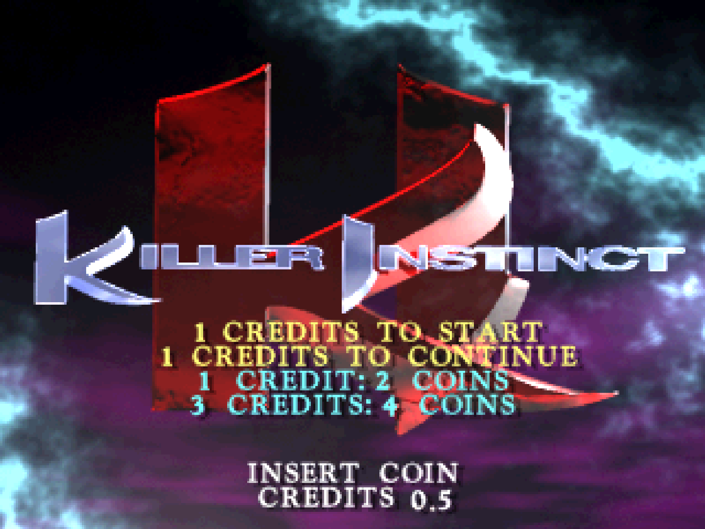
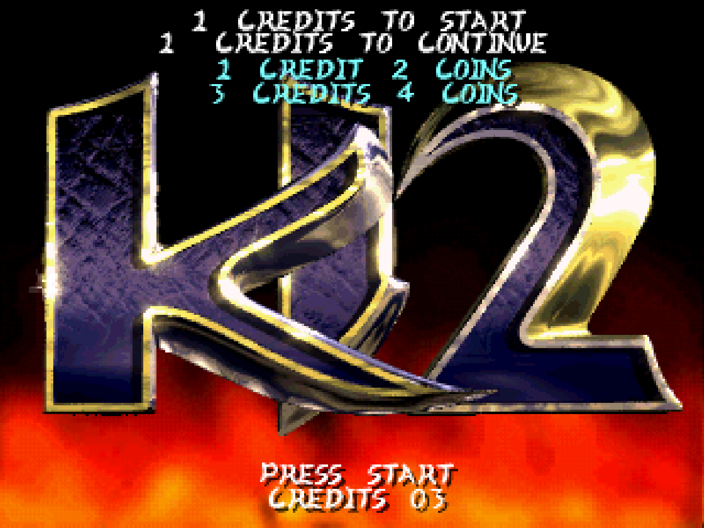

# Killer Instinct MiSTer core

MiSTer FPGA implementation of the Midway Killer Instinct arcade hardware used
by Killer Instinct (1994) and Killer Instinct 2 (1996).

## Hardware Requirements

SDRAM of any size is required.

## Features

Both KI1 and KI2 boot and are fully playable on MiSTer. The core
implements:

- R4600-compatible MIPS III CPU execution, caches, exceptions and interrupts.
- Midway DCS Audio with an ADSP-2105-compatible HDL engine and all eight sound
  ROM banks.
- Original 320 x 240 video, framebuffer page flipping and BGR555 output.
- ATA PIO access to raw disk images through MiSTer's mounted-image interface.
- Controls, coins, Start, Service, Test and Pause
- Game DIP switches.
- Native/60 Hz CRT timing modes.
- Original/Wide Screen aspect ratios
- Optional horizontal crop
- Core Pause
- MAME-compatible keyboard mappings
- DB15 SNAC

## Accuracy

See [Core vs Original Hardware](core-hardware-comparison.md)

## Media

ROM and disk data are not included. MRAs are supplied for the dumped KI and
KI2 revisions and use the unmodified MAME ZIP names. Match the MRA, ROM ZIP and
disk image from the same game set.

MAME merged kinst.zip and kinst2.zip should be placed in ```games/mame/```

MiSTer's image interface needs a raw sector image rather than a CHD. Prepare
them with:

```text
chdman extracthd -i kinst.chd -o kinst.img
chdman extracthd -i kinst2.chd -o kinst2.img
```

Place the resulting image files in their respective folders ```games/kinst/``` or ```games/kinst2/```.

[ki-rom](https://github.com/nekuz0r/ki-rom) custom boot ROM release should be zipped as ki-rom.zip and placed in ```games/hbmame/```

## Extras
Included PDF character move lists can be placed in ```docs/kinst/``` and ```docs/kinst2/``` and viewed in core through the Help menu in the OSD.

## Credits
Core by [Keith Conger](https://github.com/kconger)

R4300i CPU adapted from the [N64](https://github.com/MiSTer-devel/N64_MiSTer) MiSTer core

`adsp2105.sv` and `dcs_mem.sv` adapted from the [Wolf Unit](https://github.com/blahm1d/wolf-unit) MiSTer core

`joy_db15.sv` adapted from the [Arcade-IremM72_MiSTer](https://github.com/MiSTer-devel/Arcade-IremM72_MiSTer) MiSTer core

[MAME](https://github.com/mamedev/mame) kinst driver as a reference

[MisterAddons](https://github.com/misteraddons) original hardware measurements